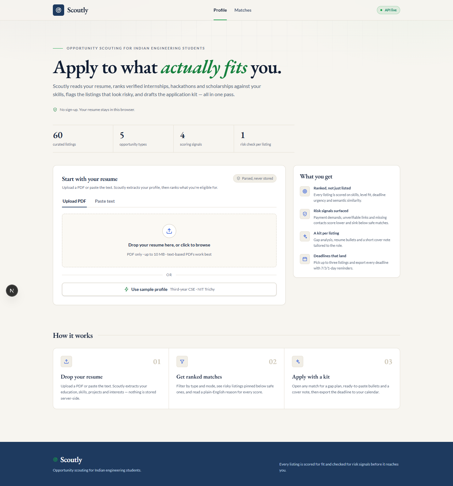
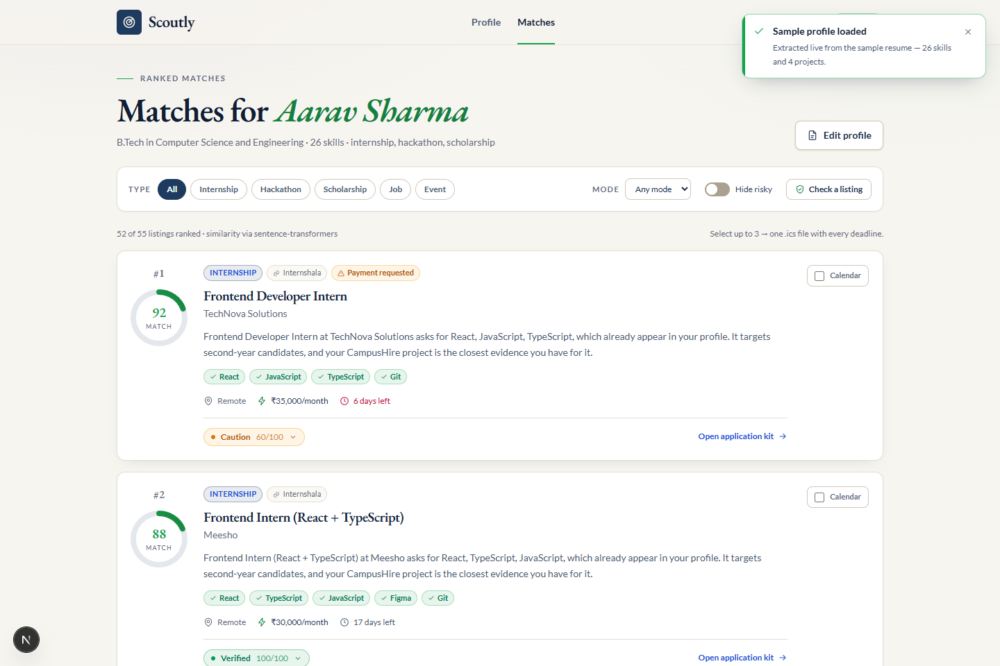
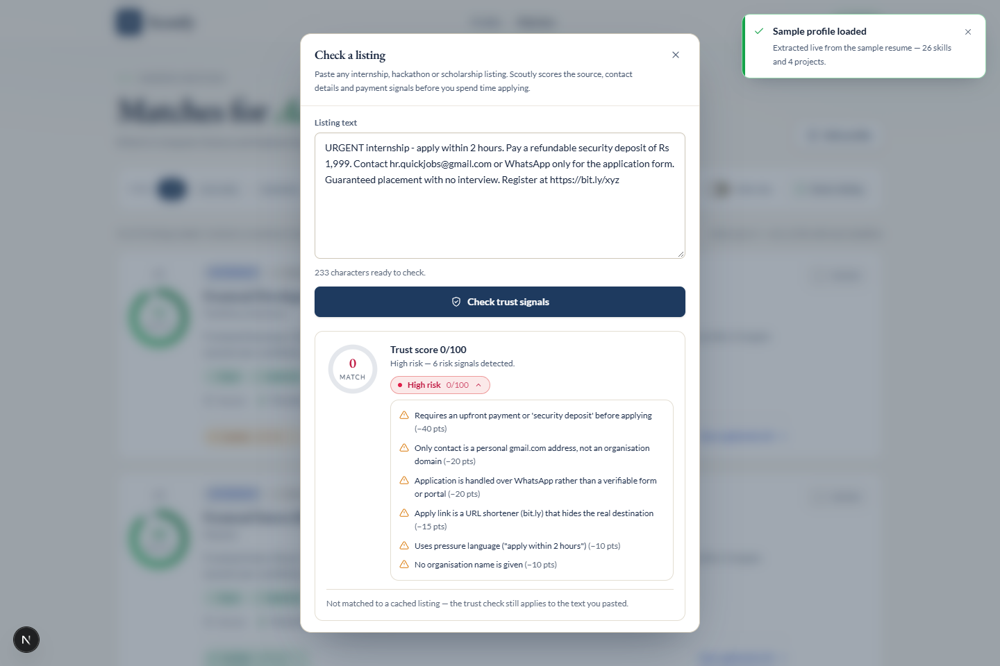
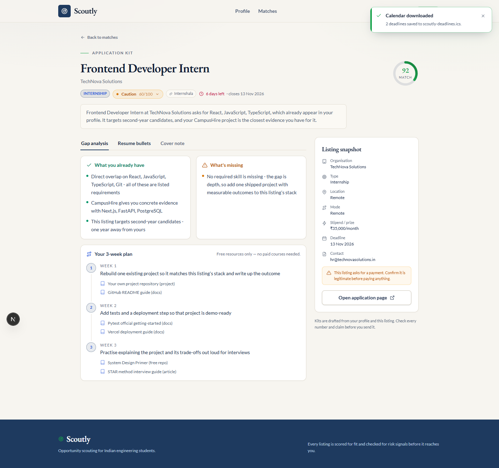
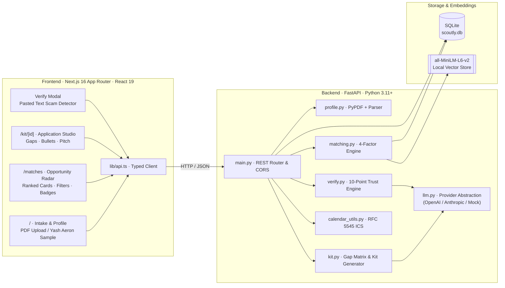

# Scoutly 🧭
### AI Opportunity Radar & Verified Application Kit for Students

[](https://fastapi.tiangolo.com)
[](https://nextjs.org)
[](https://react.dev)
[](https://tailwindcss.com)
[](https://www.python.org)
[](https://www.typescriptlang.org)
[](scoutly/backend/tests)
[](LICENSE)

> **Students don't lack opportunities — they lack time and trust.**  
> Scoutly reads your resume, extracts your core strengths, scores verified internships, hackathons, and scholarships with an **explainable 4-factor matching engine**, screens out predatory scams with an **autonomous trust heuristic engine**, and generates a **personalized application kit** with calendar sync in seconds.

---

## 📸 Product Walkthrough & Screens

| 01 · Resume Intake & Profile Parsing | 02 · Ranked Matches & Trust Badging |
| :---: | :---: |
|  |  |
| *Upload PDF, paste text, or load demo profile. Instant structured extraction.* | *4-factor explainable scoring + real-time trust risk classification.* |

| 03 · Autonomous Trust & Scam Verification | 04 · Tailored Application Kit & Gap Roadmap |
| :---: | :---: |
|  |  |
| *Check any opportunity link or pasted message against 10 risk heuristics.* | *Actionable skill gap analysis, week-by-week roadmap, and XYZ resume bullets.* |

```
                              THE SCOUTLY LIFECYCLE
                              
  [ Resume PDF / Text ] 
            │
            ▼
  [ Instant Profile Extraction ] ──► (Skills, Projects, Education, Graduation Year)
            │
            ▼
  [ Explainable Match Engine ]   ──► 4-Factor Weighted Score (Semantic + Skills + Level + Urgency)
            │
            ▼
  [ 10-Point Trust Verifier ]    ──► Risk Flagging (Verified 75+ | Caution 45-74 | High Risk <45)
            │
            ▼
  [ Tailored Application Kit ]   ──► Gap Analysis + 3-Week Plan + XYZ Bullets + Cold Pitch
            │
            ▼
  [ 1-Click .ICS Calendar Sync ] ──► Auto-reminders 7, 3, and 1 day prior to deadline
```

---

## ⚡ Key Highlights & Value Proposition

1. **Zero-Configuration Local First Architecture:**
   - Runs completely offline: 1 FastAPI process, 1 SQLite database, and 1 Next.js 16 frontend.
   - Built-in graceful degradation: Falls back cleanly to deterministic mock payloads if no LLM API key is provided.
   - Pre-loaded with 60 realistic seed listings tailored for Indian engineering students (internships, hackathons, open-source cohorts, scholarships, and jobs).

2. **Explainable 4-Factor Matching Engine (Not a Black Box):**
   - Combines calibrated semantic similarity (`all-MiniLM-L6-v2`), deterministic skill overlap with synonym normalization, academic level fit, and deadline urgency into a verifiable 0–100 score.
   - Never leaves the student guessing: every match card displays full score breakdowns and an evidence-grounded *"Why this fits you"* rationale.

3. **Autonomous Scam & Predatory Listing Shield:**
   - 10-point rule engine analyzes fee requirements, personal email domains (Gmail/Yahoo), WhatsApp/Telegram-only application funnels, URL shorteners, and unrealistic guarantees.
   - High-risk listings are quarantined and pinned to the bottom with transparent risk disclosures instead of silently disappearing.
   - Dedicated **"Check a listing"** sandbox allows students to test suspicious copy-pasted messages before applying.

4. **Production-Ready Application Kit:**
   - **Gap Analysis & Roadmap:** Distinguishes what skills you already have versus what's missing, paired with a realistic 3-week study roadmap citing free, reputable sources.
   - **Google XYZ Resume Bullets:** Contextual accomplishments written specifically for the target opportunity using your verified projects.
   - **High-Impact Cold Outreach:** Concise (<150 words) cold email/DM pitch ready to copy.
   - **Multi-Calendar Sync:** Multi-select opportunities to export `.ics` files with automated 7-day, 3-day, and 1-day reminders.

---

## 🏗️ Architecture & Technical Stack



### Stack Breakdown

- **Frontend:** Next.js 16 (Turbopack, App Router), React 19, Tailwind CSS v4, Lucide React, Plus Jakarta Sans & Inter typography.
- **Backend:** FastAPI, Pydantic v2, SQLAlchemy, Uvicorn.
- **NLP & Vectors:** `sentence-transformers` (`all-MiniLM-L6-v2`) with cosine calibration and hashing TF-IDF fallback.
- **Trust & Verification Engine:** Deterministic rule-based heuristic penalty matrix + optional LLM second opinion.
- **Testing:** 163 offline pytest tests covering algorithms, duplicates, calendar parsing, and edge cases.

---

## 🧮 How Matching Works (Explainable Formulation)

Rather than delegating ranking to an unpredictable LLM prompt, Scoutly computes a deterministic score:

$$\text{Match Score} = 100 \times \left(0.45 \cdot S_{\text{semantic}} + 0.30 \cdot S_{\text{skills}} + 0.15 \cdot S_{\text{level}} + 0.10 \cdot S_{\text{urgency}}\right)$$

| Component | Weight | Logic & Computation |
| :--- | :---: | :--- |
| **Semantic Similarity** | **45%** | Cosine similarity between student profile embeddings and listing details via `all-MiniLM-L6-v2`. Linearly calibrated from $[0.05, 0.45]$ to $[0, 1.0]$. |
| **Skill Overlap** | **30%** | $\frac{|\text{Profile Skills} \cap \text{Required Skills}|}{|\text{Required Skills}|}$ normalized with an engineering synonym dictionary (`js` $\rightarrow$ `javascript`, `k8s` $\rightarrow$ `kubernetes`, `ml` $\rightarrow$ `machine learning`). |
| **Level Fit** | **15%** | Evaluates student graduation year: `1.0` for exact match / any, `0.5` for adjacent year, `0.2` otherwise. |
| **Deadline Urgency** | **10%** | Bell curve favoring applications due within 3–14 days (peaks at 8 days = `1.0`). Expired listings receive `0.0` and are automatically dropped. |

---

## 🛡️ Trust & Risk Detection System

Every opportunity is scored out of 100 on trustworthiness. Points are deducted for verifiable warning signs:

| Rule Flag | Severity Code | Deduction | Description |
| :--- | :--- | :---: | :--- |
| **Upfront Fee / Deposit** | `payment_required` | **-40** | Asking students for training fees, security deposits, or kit charges. |
| **Personal Email Only** | `free_email_contact` | **-20** | Contact address is `@gmail.com`, `@yahoo.com`, etc. with no official domain. |
| **Chat-Only Funnel** | `chat_only_application` | **-20** | Applying exclusively via WhatsApp, Telegram, or direct message. |
| **Unverifiable Apply Link** | `unverifiable_apply_url` | **-15** | Bitly links, shorteners, or broken URLs instead of verified domains. |
| **Unrealistic Stipend** | `unrealistic_compensation` | **-20** | Outlandish compensation promises for entry-level / no-experience roles. |
| **High-Pressure Urgency** | `urgency_pressure` | **-10** | "Apply within 2 hours", "Only 2 spots left", or false scarcity tactics. |
| **Implausible Guarantee** | `implausible_promise` | **-10** | "Guaranteed job offer without interview", "100% PPO direct hire". |
| **Anonymous Organization** | `missing_org_details` | **-10** | "Top MNC (Name withheld)", "Confidential hiring partner". |
| **Conflicting Duplicate** | `conflicting_duplicates` | **-10** | Identical role posted elsewhere with conflicting compensation or details. |

**Trust Classification Tiers:**
- 🟢 **Verified (Score $\ge 75$):** High integrity listing from a verified company/institution.
- 🟡 **Caution (Score $45 - 74$):** Minor flags present; student should verify contact details.
- 🔴 **High Risk (Score $< 45$):** Multiple critical warning signs. Pinned to the bottom of results with clear risk explanations.

---

## 🚀 Quick Start Guide

### Prerequisites
- **Python 3.11+** (tested on Python 3.11 & 3.12)
- **Node.js 20+** (tested on Node 20 & 24)
- **Git**

### 1. Clone the Repository
```bash
git clone https://github.com/yash-aeron/Hackathon.git
cd Hackathon
```

### 2. Launch the Backend
Open a terminal in the repository root:

```bash
# Navigate to backend directory
cd scoutly/backend

# Create virtual environment (optional but recommended)
python -m venv venv
# Windows:
.\venv\Scripts\activate
# macOS/Linux:
# source venv/bin/activate

# Install dependencies
pip install -r requirements.txt

# Configure environment (default .env uses mock mode, no API key needed!)
cp .env.example .env

# Seed initial 60 verified listings into SQLite
python seed.py

# Start FastAPI server
uvicorn main:app --reload --port 8000
```
*Backend runs at:* `http://127.0.0.1:8000`  
*Swagger API Docs:* `http://127.0.0.1:8000/docs`

### 3. Launch the Frontend
Open a second terminal:

```bash
# Navigate to frontend directory
cd scoutly/frontend

# Install node dependencies
npm install

# Start Next.js development server
npm run dev
```
*Frontend runs at:* `http://localhost:3000`

---

## 🧪 Testing & Verification

The backend includes a comprehensive, offline test suite with **163 unit and integration tests**:

```bash
cd scoutly/backend
python -m pytest -v
```

### Test Suite Coverage:
- `test_matching.py`: Skill normalizations, synonym mappings, academic level fit, deadline urgency, calibrated score weights.
- `test_duplicates.py`: Near-duplicate detection, collapsing conflicting reposts, ranking contracts.
- `test_verify.py`: 10 trust rules, penalty calculations, density policy, text scam verification.
- `test_calendar.py`: RFC 5545 VCALENDAR generation, alarm reminders (7, 3, 1 day), multi-event parsing.
- `test_kit.py`: Skill gap matrices, 3-week roadmap generation, Google XYZ resume bullets, cover note limits.
- `test_llm.py`: Strict JSON validation, repair retries, timeout handling, mock-mode fallback.
- `test_profile.py`: Resume text extraction, section segmentation, project detection.
- `test_api.py`: Complete endpoint test suite including CORS, error handling, and parameter validation.

---

## 📁 Repository Structure

```
Hackathon/
├── README.md                      # Project root documentation (this file)
└── scoutly/                       # Scoutly application workspace
    ├── backend/                   # FastAPI backend
    │   ├── main.py                # REST endpoints, CORS & lifespan events
    │   ├── models.py              # Pydantic schemas & SQLAlchemy models
    │   ├── matching.py            # 4-factor scoring & ranking algorithm
    │   ├── verify.py              # 10-point trust heuristic engine
    │   ├── kit.py                 # Gap analysis & application kit generator
    │   ├── profile.py             # Resume parser & extraction heuristics
    │   ├── llm.py                 # LLM provider wrapper (OpenAI/Anthropic/Mock)
    │   ├── prompts.py             # Versioned system prompts with guardrails
    │   ├── calendar_utils.py      # .ics calendar generator with reminders
    │   ├── config.py              # Environment configuration & defaults
    │   ├── db.py                  # SQLite database engine
    │   ├── seed.py                # Database seeder with relative date offsets
    │   ├── data/
    │   │   ├── listings.json      # 60 curated opportunities
    │   │   └── sample_resume.txt  # Yash Aeron test candidate profile
    │   ├── tests/                 # 163 pytest unit & integration tests
    │   └── requirements.txt       # Python dependencies
    ├── frontend/                  # Next.js 16 frontend
    │   ├── app/                   # App Router pages (/ · /matches · /kit/[id])
    │   │   ├── layout.tsx         # Root layout with Plus Jakarta Sans & Inter
    │   │   ├── globals.css        # Tailwind CSS v4 design tokens & themes
    │   │   └── page.tsx           # Home & resume intake page
    │   ├── components/            # UI components
    │   │   ├── home/              # Upload panel, quick-start profile cards
    │   │   ├── matches/           # Match cards, filter bar, selection bar
    │   │   ├── kit/               # Roadmap, resume bullets, cold pitch tab
    │   │   ├── verify/            # Paste-a-listing scam verification modal
    │   │   └── site-header.tsx    # Clean navigation header
    │   ├── lib/                   # API client, TypeScript definitions, storage
    │   └── package.json           # Frontend dependencies & scripts
    └── docs/
        └── screenshots/           # Full-resolution browser walkthrough captures
```

---

## 👥 Authors & Acknowledgments

- **Yash Aeron** — Full-stack AI engineering, matching algorithm design, frontend architecture & verification engine.
- Built for the Hackathon sprint with focus on empowering engineering students with explainable AI and trusted opportunities.
