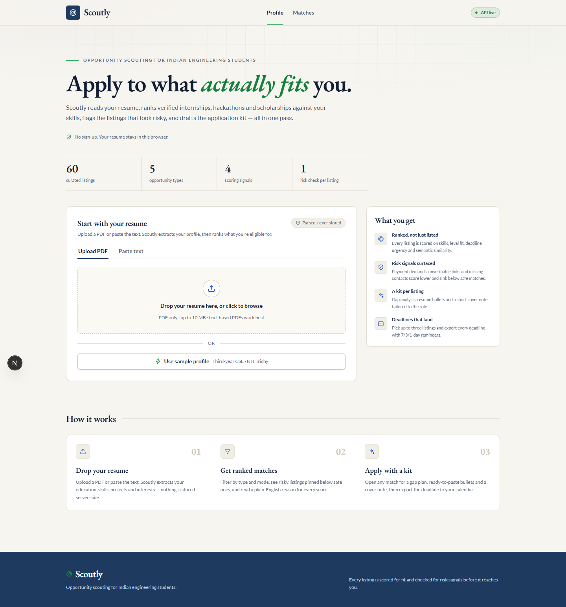
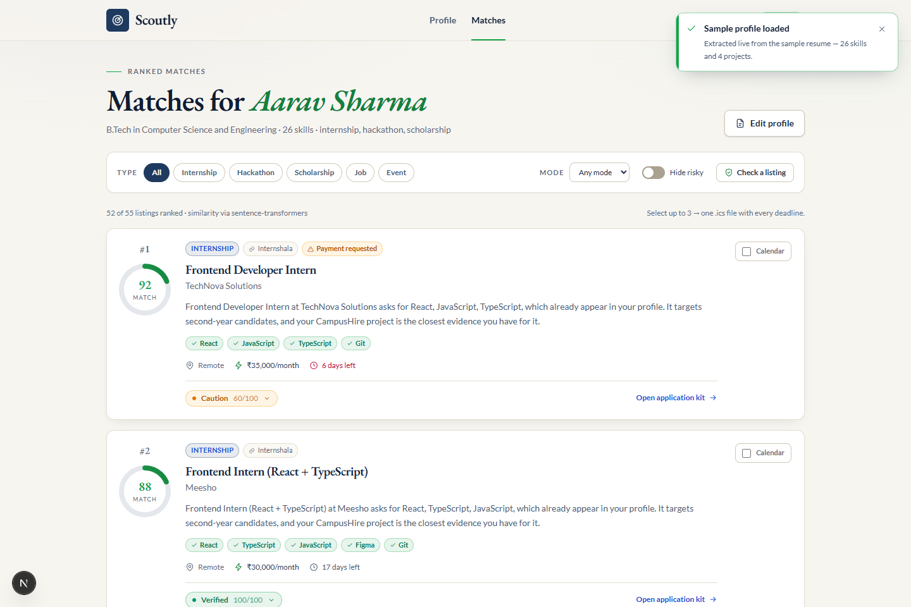
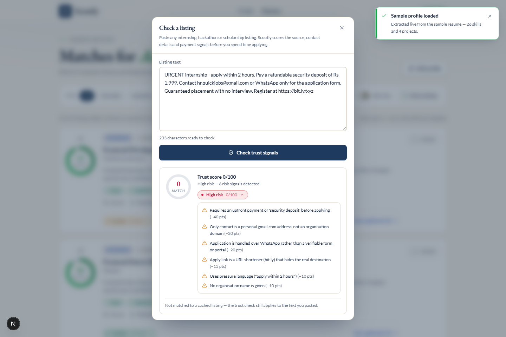
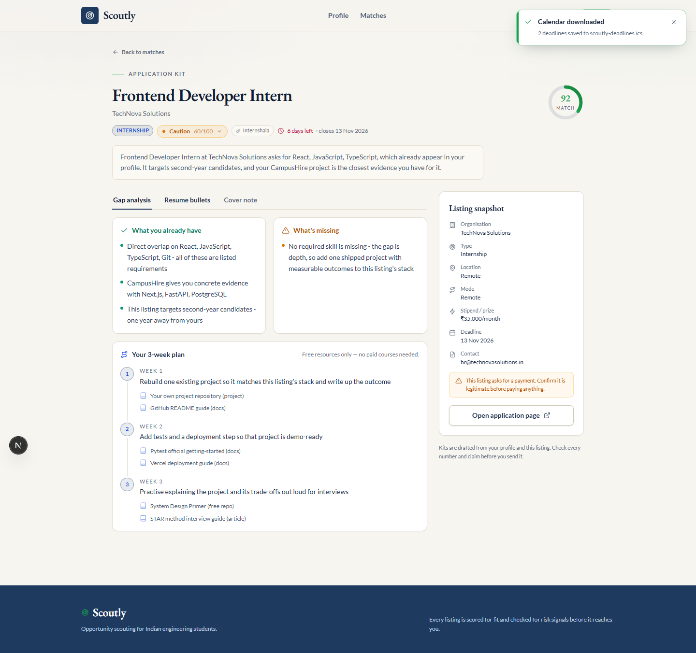
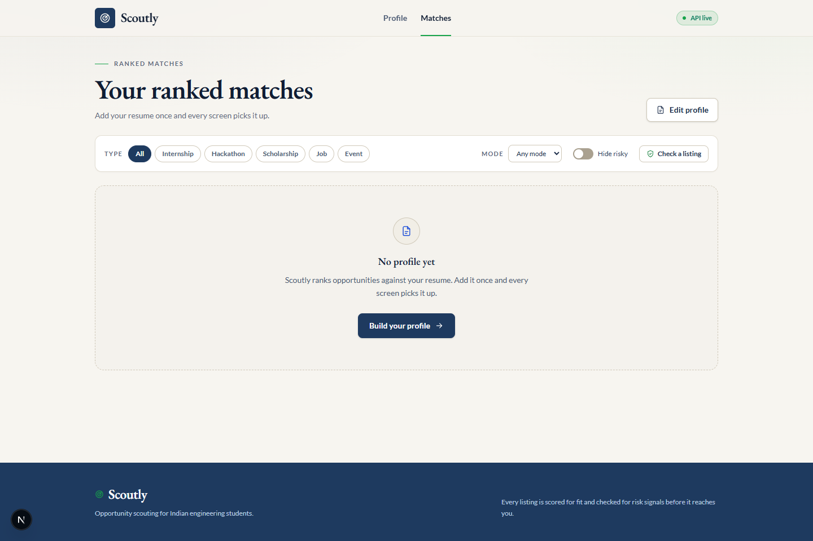
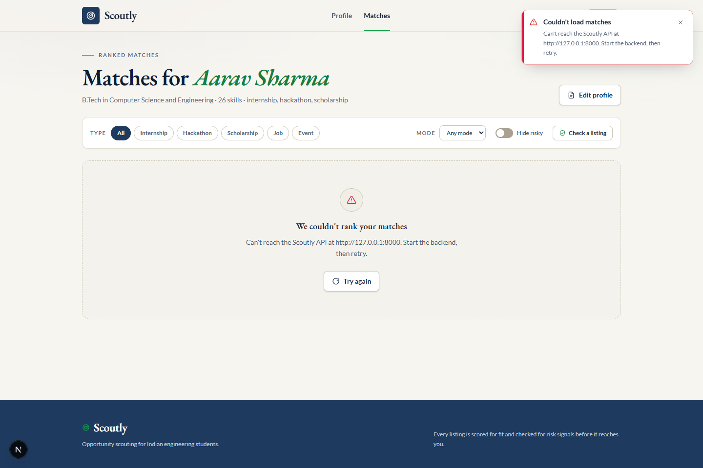
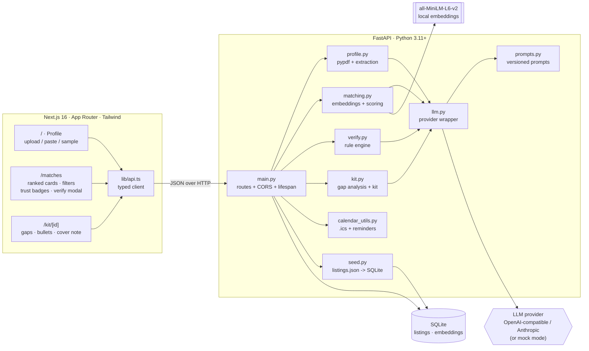

# Scoutly

**Students don't lack opportunities, they lack time and trust.**

Scoutly is an AI agent that finds the right internships, hackathons, events, jobs and
scholarships for a student, **verifies** each listing before they spend time on it, and
generates a tailored application kit plus a deadline calendar.

Everything runs locally: one FastAPI process, one SQLite file, one Next.js app. No
sign-up, no external database, no scraping credentials.

> **The repo folder is `opportunara/` (required by the brief); the product is Scoutly.**

---

## Screens

| Profile + resume upload | Ranked matches with trust badges |
|---|---|
|  |  |

| Verify any pasted listing | Application kit (gap analysis + roadmap) |
|---|---|
|  |  |

| Empty state (no profile yet) | Error state (API unreachable) |
|---|---|
|  |  |

Every state is captured from a real browser run (`scripts/e2e-browser.cjs`), not mocked:
loaded, empty, error-with-retry, modal, mobile, and all three kit tabs.

The full flow, in one line:

```
resume (PDF) -> extracted profile -> ranked matches with "why this fits"
             -> trust badge per listing -> gap analysis + 3-week roadmap
             -> resume bullets + cover note -> .ics deadline calendar
```

---

## Quick start

**Backend** (terminal 1, from the repo root):

```bash
cd opportunara/backend
pip install -r requirements.txt
cp .env.example .env          # defaults are safe: no key = mock mode
python seed.py
uvicorn main:app --reload --port 8000
```

**Frontend** (terminal 2):

```bash
cd opportunara/frontend
npm install
npm run dev                    # http://localhost:3000
```

That is it — the app works with **zero configuration**. The backend auto-seeds the
catalogue on first boot if the database is empty, and everything (including every LLM
call) works with no API key by falling back to realistic canned JSON.

First boot warms the embedding model (`all-MiniLM-L6-v2`, ~15-25 s on CPU) in the
background; `GET /api/health` shows `embeddings_backend` as `loading` until it is ready.
Matching still works during warm-up (it just scores without the semantic component).
For a fast cold start set `EMBEDDING_BACKEND=hashing`.

### Requirements

- Python 3.11+ (tested on 3.12)
- Node 20+ (tested on 24)
- ~2 GB free disk for `torch` (CPU build) — optional, see graceful fallback below

---

## Architecture



**One request, one path:** `/api/match` loads listings from SQLite, calculates trust for
each (`verify.py`), embeds the profile (`matching.py`), scores and collapses duplicates,
then fans out concurrent "why it fits" LLM calls for the top 10 with `asyncio.gather`.

---

## How matching works (explainable, not pure LLM)

```
score = 100 * (0.45 * semantic_similarity
             + 0.30 * skill_overlap
             + 0.15 * level_fit
             + 0.10 * deadline_urgency)
```

| Component | Meaning |
|---|---|
| `semantic_similarity` | Cosine between the profile document (skills + projects + interests) and the listing document, embedded locally with `all-MiniLM-L6-v2`. |
| `skill_overlap` | `matched / required`, after lowercase normalisation and a synonym map (`js`→`javascript`, `ml`→`machine learning`, `k8s`→`kubernetes`, …). A listing with no required skills scores a neutral `0.5`. |
| `level_fit` | `1.0` exact or `any`, `0.5` adjacent year, `0.2` otherwise, `0.5` when the profile year is unknown. |
| `deadline_urgency` | Peaks inside the 3-14 day window (up to `1.0` at 8 days), `0.4` under 3 days, tapering to `0.1` beyond 30 days, `0.0` when expired. |

Hard filters, applied before ranking:

1. **Expired listings are dropped.**
2. **Near-duplicates collapse** — same normalised title + organisation from different
   sources keeps the higher-trust repost (ties break on a richer description).
3. **High-risk listings are kept but pinned last** with a red badge, unless
   `hide_risky` is true — the point is to show risk detection, not hide it.

Every response carries `score_breakdown` (each component 0-1 plus its weighted points)
so the UI can always answer *"why did this rank here?"*. The `why_it_fits` sentence pair
is grounded by prompt guardrails and has a deterministic, facts-only fallback.

**Semantic calibration (documented decision):** MiniLM cosine between a resume and a
listing almost always lands in `0.05-0.45`, so a raw cosine would make excellent matches
look mediocre. `matching.calibrate_semantic()` linearly rescales that observed band onto
`0..1` while keeping the raw embeddings. The bounds are named constants
(`SEMANTIC_FLOOR`, `SEMANTIC_CEILING`) in `matching.py`.

---

## How verification works (trust score)

Rules start at 100 and subtract for each verifiable signal. Every flag carries a short
human-readable reason that the UI shows; the copy never says "scam" or "fraud", only
that the listing **shows risk signals**.

| Rule | Code | Penalty |
|---|---|---|
| Requires payment / "security deposit" / registration or kit fee | `payment_required` | −40 |
| Only contact is a free email provider (Gmail/Yahoo/…) | `free_email_contact` | −20 |
| Application happens over Telegram / WhatsApp / DM | `chat_only_application` | −20 |
| No apply link, a URL shortener, or a chat link instead of a careers page | `unverifiable_apply_url` | −15 |
| Compensation wildly above market for the role and level | `unrealistic_compensation` | −20 |
| Pressure language ("apply within 2 hours", "limited seats") | `urgency_pressure` | −10 |
| Implausible promise ("guaranteed PPO", "no interview", "immediate joining") | `implausible_promise` | −10 |
| Organisation not identifiable ("Top MNC (name withheld)", "A Fast-Growing Tech Startup") | `missing_org_details` | −10 |
| Reposted by another source with conflicting details | `conflicting_duplicates` | −10 |
| Deadline already passed | `expired` | 0 (informational) |

**Levels:** `>= 75` verified, `45-74` caution, `< 45` high-risk.

**Density policy:** two independent risk signals can never be `verified`, and three or
more are always `high-risk` (score capped at 44). A single weak signal stays mild; a
listing that piles up red flags cannot hide behind a high average.

**LLM second opinion (optional):** on `POST /api/verify` the model may add up to two
extra flags with cited evidence. It can only *lower* the score, never raise it above the
rule-based result. The rule engine alone is used for the 60-listing match pass, so
ranking never waits on 60 model calls.

---

## LLM layer

`backend/llm.py` exposes a single async call — `complete_json(task, system, user, schema, fallback)` —
that always returns a validated Pydantic model:

- **Providers:** any OpenAI-compatible `/chat/completions` endpoint (`LLM_BASE_URL`
  configurable: OpenAI, OpenRouter, Groq, local vLLM/Ollama, …) and Anthropic Messages.
- **Strict JSON:** `response_format={"type": "json_object"}` for OpenAI-compatible
  providers; an explicit instruction plus markdown-fence stripping for Anthropic.
- **Validate + retry once:** a parse or schema failure triggers one repair attempt that
  includes the validation error, then a deterministic fallback payload.
- **Bounded:** every call has a `LLM_TIMEOUT_SECONDS` timeout (default 10 s) and a
  concurrency semaphore (6), so the per-listing fan-out is safe on rate-limited tiers.
- **Mock mode:** `MOCK_LLM=true` **or** no API key ⇒ every call returns the caller's
  realistic canned payload instantly. `/api/health` reports `mock_llm: true`, and the UI
  labels it in the header.

Prompts live in `backend/prompts.py` as versioned constants (`PROMPT_VERSION`), each
ending with the guardrail: *"Use only facts present in the provided profile and listing.
If something is unknown, leave it out."*

### Graceful degradation

| Failure | Behaviour |
|---|---|
| No API key / `MOCK_LLM=true` | Canned JSON everywhere; app fully functional. |
| Provider down, 429, timeout, bad JSON | Deterministic fallback (rule-based copy/bullets/roadmap) + `ai_available: false` + `note`, rendered as an inline **"AI unavailable — showing basic results"** notice. |
| `sentence-transformers`/torch unavailable | Deterministic hashed TF-IDF embeddings (`hashing` backend); ranking still works and `/api/health` reports it. |
| Embeddings still warming | Matching scores without the semantic component instead of blocking. |

---

## Environment variables

Backend (`backend/.env`, see `.env.example`):

| Variable | Default | Purpose |
|---|---|---|
| `LLM_PROVIDER` | `openai` | `openai` (any compatible endpoint), `anthropic`, or `mock`. |
| `LLM_API_KEY` | *(empty)* | Provider key. Empty ⇒ mock mode. |
| `LLM_MODEL` | `gpt-4o-mini` | Model id understood by the provider. |
| `LLM_BASE_URL` | *(empty)* | Base URL for OpenAI-compatible endpoints, e.g. `https://openrouter.ai/api/v1`. |
| `MOCK_LLM` | `true` | Force canned JSON even with a key. Recommended for stage demos. |
| `LLM_TIMEOUT_SECONDS` | `10` | Per-call timeout before falling back. |
| `DATABASE_URL` | `sqlite:///./scoutly.db` | SQLite file (relative paths anchor to `backend/`). |
| `CORS_ORIGINS` | `http://localhost:3000,http://127.0.0.1:3000` | Allowed browser origins. |
| `EMBEDDING_MODEL` | `sentence-transformers/all-MiniLM-L6-v2` | Local embedding model. |
| `EMBEDDING_BACKEND` | `auto` | `auto` (model, fallback to hashing) or `hashing` (skip torch). |

Frontend (`frontend/.env.local`): `NEXT_PUBLIC_API_URL` (default `http://127.0.0.1:8000`).

No secrets are committed: `.env` is gitignored and `.env.example` ships blank.

---

## API

| Method | Path | Description |
|---|---|---|
| `GET` | `/api/health` | Version, LLM mode/provider, catalogue size, embedding backend. |
| `GET` | `/api/listings?types=&mode=&limit=` | Browse the seeded catalogue (soonest deadline first). |
| `GET` | `/api/sample-resume` | Bundled demo resume text + instantly parsed profile. |
| `POST` | `/api/profile/parse` | `multipart/form-data` field `file` (PDF) **or** JSON `{text}` → `StudentProfile`. |
| `POST` | `/api/match` | `{profile, filters?, hide_risky?, limit?}` → ranked matches, each with score, `score_breakdown`, `why_it_fits`, matched/missing skills, `trust`, `days_left`. |
| `POST` | `/api/verify` | `{listing_id}` **or** `{text}` → trust score/level/flags. Works on any pasted listing. |
| `POST` | `/api/kit` | `{profile, listing_id, regenerate?}` → gap analysis + roadmap + 3-5 resume bullets + cover note (≤150 words) + one-liner. |
| `GET` | `/api/calendar.ics?listing_ids=1,2,3` | `.ics` download: one all-day event per deadline with 7/3/1-day reminders. |

Interactive docs: <http://127.0.0.1:8000/docs>

**Top 10 by default.** `POST /api/match` returns the top 10 unless `limit` asks for more,
and only those top 10 get an LLM-written `why_it_fits` (the rest keep the deterministic
explanation). The UI requests a wider ranked list (60) so its type/mode filters and
"hide risky" toggle operate on the full catalogue without extra round-trips.

---

## Data model

`Listing` — id, title, organization, type (`internship | hackathon | scholarship | job | event`),
description, required_skills[], level (`first-year … final-year | any`), location, mode
(`remote | onsite | hybrid`), stipend_or_prize (nullable), deadline (ISO date), apply_url,
contact_email (nullable), source, posted_date, requires_payment.

Embeddings are stored **separately** in `listing_embeddings` (listing id + model name +
text hash + `float32` bytes) so they can be recomputed when the model or text changes
without touching the listings table.

`StudentProfile` — name, education `{degree, college, year}`, skills[], projects
`[{name, summary, tech[]}]`, experience[], interests[], target_types[], location_pref,
raw_text.

### Seed data — **sample data only**

`backend/data/listings.json` contains **60 realistic sample listings** for Indian
engineering students (software, AI/ML, data, design, product, research; internships,
hackathons, scholarships, jobs and events). Deadlines are stored as **offsets relative to
seed time** (`deadline_offset_days`) and converted to real dates by `seed.py`, so the
dataset never goes stale.

It deliberately contains, for demoing trust features:

- **8 suspicious listings** carrying real signals (fee/deposit, personal Gmail, Telegram/
  WhatsApp-only, URL shortener, implausible stipend, "apply in 2 hours", anonymous org).
- **5 expired listings** (deadlines in the past).
- **3 near-duplicate pairs** (same title + organisation, different source, one pair with
  conflicting stipends).

> **These are not real, live opportunities.** Replace `backend/data/listings.json` with
> real listings before using Scoutly for anything beyond a demo. See *Known limitations*.

---

## Tests

```bash
cd opportunara/backend
python -m pytest          # 163 tests, ~2 s, fully offline
```

Coverage of the quality bar:

- `test_matching.py` — skill normalisation/synonyms, level fit, deadline urgency, score
  composition (weights sum to 1, perfect = 100, clamping), semantic calibration.
- `test_duplicates.py` — near-duplicate detection (same title + org), conflicting-stipend
  reposts, collapsing keeps the higher-trust repost, case/punctuation insensitivity, plus
  the ranking contract: expired dropped, filters honoured, high-risk pinned last,
  `hide_risky`, `limit`, explainable breakdowns, vector-driven scores.
- `test_verify.py` — one test per trust rule (positive and negative), penalty table,
  density policy, pasted-text scam/clean cases, amount parsing, expired stays informational.
- `test_calendar.py` — VCALENDAR structure, one event per deadline, 7/3/1-day alarms,
  custom reminders, skipped undated listings, empty input raises.
- `test_kit.py` — gaps only for missing skills, 3-5 week roadmap, resources never
  fabricated as URLs, cover note ≤150 words, one-liner grammar, sanitiser behaviour,
  mock-mode generation.
- `test_llm.py` — JSON extraction (fences/preamble), mock mode, single retry, transport
  and validation fallbacks, provider normalisation, guardrail present in every prompt.
- `test_profile.py` — deterministic resume extraction: sections, name, education, skills,
  projects with tech, experience with employer context, interests, target types.
- `test_seed.py` — 60 rows, exact schema, 8 detectable suspicious, 5 expired, 3 duplicate
  pairs, relative-date conversion, idempotent seeding.
- `test_api.py` — every endpoint plus error paths (404/400/415/422) and CORS.

Extra verification helpers:

```bash
python smoke_test.py                 # end-to-end API walkthrough, prints every result
node ../scripts/e2e-browser.cjs      # real-browser walkthrough + screenshots (Playwright)
```

---

## Two-minute demo script

**0:00 — Home (`/`).** "Students don't lack opportunities, they lack time and trust.
Scoutly does four things: reads the resume, ranks what fits, verifies the source, and
drafts the application."

**0:10 — Load the resume.** Click **Use sample profile** (or drag the sample PDF / paste
text). The profile card appears: name, education, 26 skills as chips, 4 projects,
interests — all editable. "Extraction runs on the model; nothing is invented, and in mock
mode the same result comes from the deterministic parser."

**0:30 — Matches (`/matches`).** "60 listings scored on skills, level fit, deadline
urgency and semantic similarity against the resume. 52 rank after dropping expired
listings and collapsing 3 duplicate reposts."

**0:50 — The trust moment.** Point at **#1**: 92 match score, but a **Caution · 60/100**
badge with **"Requires an upfront payment or security deposit"**. "This is the whole
product: a great fit is not the same as a safe bet." Scroll to the pinned bottom —
**High risk** cards ("Work From Home Data Entry", org *"Top MNC (name withheld)"*). Click
a badge: every risk signal expands with a plain-English reason and its point deduction.

**1:10 — Check a listing (the scam demo).** Click **Check a listing**, paste the staged
message (fee + Gmail + WhatsApp-only + bit.ly + "no interview"). Trust **0/100,
High risk, 6 signals** — including flags the student would have missed.

**1:25 — Application kit (`/kit/[id]`).** Open the top match. Gap analysis shows what the
student already has vs what is missing; the week-by-week roadmap names free resources
only. Tab through **Resume bullets** (built from the student's real projects, copy button
on each) and **Cover note** (84 words, specific, no fluff, copy + regenerate).

**1:45 — Calendar.** Go back, tick up to three listings, click **Download calendar** —
`scoutly-deadlines.ics` with an all-day event per deadline and reminders 7, 3 and 1 days
before.

**1:55 — Close.** "Resume to a verified shortlist and a filled-in application kit in
under two minutes. Everything runs locally: FastAPI, SQLite, local embeddings."

---

## Design decisions & deviations

- **Visual language (redesigned after the first pass, at the team's request).** The UI now
  uses warm paper surfaces (`#f7f5f0`), institutional navy plus funding green, and an
  EB Garamond / Lato pairing — a deliberate move away from the brief's
  dark-navy/electric-blue. The whole palette is defined once in `app/globals.css`
  (`@theme`, which also remaps Tailwind's `slate`/`ink`/`brand`/`accent` scales); components
  consume only semantic tokens, so re-theming is a one-file change. Toast, modal, score
  ring and inline notices were reworked to match, and empty/error/loading states are
  screenshot-verified in a real browser.
- **`backend/profile.py` keeps its required name but shadows CPython's stdlib `profile`
  module**, which torch imports through `cProfile`. A PEP 562 module-level `__getattr__`
  delegates unknown attributes to the real stdlib module, so both work. (Without it,
  `sentence-transformers` fails to import with a misleading `PreTrainedModel` error.)
- **Mock mode is the default** in `.env.example` and the shipped local `.env`, because
  the demo must never stall on a network call. Point `LLM_BASE_URL`/`LLM_MODEL` at any
  provider and set `MOCK_LLM=false` for live generation.
- **`ai_available` in mock mode is `true`** — mock is a *configured provider*, not a
  failure. Real failures still return `false` plus a note, and the UI shows the
  "AI unavailable" notice only in that case. `/api/health.mock_llm` lets the UI label
  demo mode honestly (header shows "mock LLM").
- **Two extra rule codes** beyond the brief's list (`free_email_contact` and
  `chat_only_application` instead of one combined contact rule) keep the two distinct
  signals visible when a listing uses *both*; and `implausible_promise` separates
  "guaranteed PPO / no interview" claims from mere time pressure.
- **Semantic similarity is calibrated** (see above) so 0-100 scores are meaningful.
- **A roadmap is always 3-5 weeks**; when nothing is missing it focuses on depth
  (rebuild, test, deploy, explain) rather than inventing fake gaps.
- **`limit` defaults to 10** as specified but accepts up to 200 because the UI asks for a
  wider ranked list for its own filters.
- **LLM explanations are capped to the top 10** per request and fan out concurrently with
  a semaphore; the rest reuse the deterministic copy.

---

## Known limitations

- **Sample data, not live listings.** All 60 listings are hand-written samples. There is
  no scraper, no aggregator integration and no live verification against source sites.
  The `source` field is descriptive only.
- **Verification is heuristic.** Rule-based signals plus an optional LLM second opinion —
  not a registry lookup, domain-age check, or company verification. It is a triage aid,
  never a guarantee; the UI deliberately says "risk signals", never "scam".
- **Career outcomes are estimates.** Matching scores are explainable proxies, not
  predictions of acceptance. `why_it_fits` is limited to facts present in the profile and
  listing, so it can read conservatively when the resume is thin.
- **No authentication or persistence of user data.** The profile lives in browser
  `localStorage`; the API is stateless per request. Multi-user, saved profiles and
  application tracking are not implemented.
- **English-only** parsing and prompts; Indian context (₹, levels, college names) is
  assumed throughout.
- **Free LLM tiers are unreliable.** Reasoning models on free tiers can spend their token
  budget "thinking" and return empty content, and free models are frequently
  rate-limited. That is exactly why mock mode exists; for live generation use a paid key
  and a non-reasoning model (`gpt-4o-mini`, `claude-3-5-haiku`, …).
- **Embeddings run on CPU** and take ~15-25 s to load at boot; set
  `EMBEDDING_BACKEND=hashing` for an instant cold start at the cost of semantic quality.

---

## Repository layout

```
opportunara/
├── backend/
│   ├── main.py            FastAPI app + routes
│   ├── models.py          SQLAlchemy tables + Pydantic schemas
│   ├── llm.py             provider wrapper, JSON mode, retries, mock mode
│   ├── prompts.py         versioned prompt constants + guardrail
│   ├── profile.py         PDF parsing + profile extraction (+ stdlib shim)
│   ├── matching.py        embeddings, scoring, duplicate collapsing, ranking
│   ├── verify.py          trust rules, density policy, pasted-text verification
│   ├── kit.py             gap analysis, roadmap, resume bullets, cover note
│   ├── calendar_utils.py  .ics generation with 7/3/1-day reminders
│   ├── config.py          env-driven settings
│   ├── db.py              SQLite engine/session
│   ├── seed.py            listings.json -> SQLite (relative dates)
│   ├── smoke_test.py      end-to-end API walkthrough
│   ├── data/listings.json 60 sample listings
│   ├── data/sample_resume.txt
│   ├── tests/             pytest suite (163 tests, fully offline)
│   ├── requirements.txt
│   ├── pytest.ini
│   └── .env.example
├── frontend/
│   ├── app/               / (profile) · /matches · /kit/[id]
│   ├── components/        home, matches, kit, ui primitives
│   ├── lib/               api.ts (typed client), types, storage, format
│   └── .env.local.example
├── scripts/e2e-browser.cjs  Playwright walkthrough + screenshots
├── docs/screenshots/
└── README.md
```

---

*Built for a 2-person hackathon sprint. Scoutly is a demo product: the scoring, the trust
engine and the kit generation are real code with real tests; the listings are not real
opportunities.*
